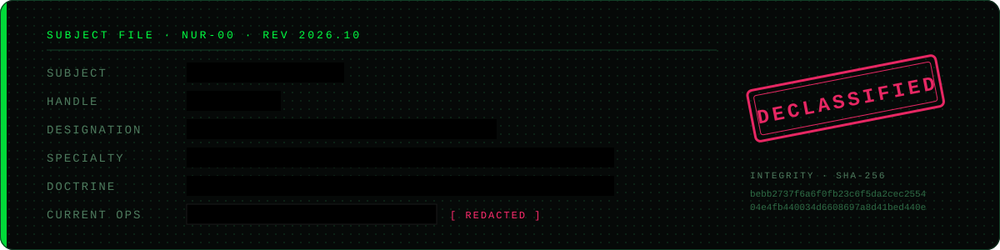

<p align="center">
  
</p>

<p align="center">
  <a href="https://linkedin.com/in/naqeeb-ur-rehman-27b357351"></a>
  <a href="mailto:naqeebrehman0326@gmail.com"></a>
  
</p>


## 👤 About Me

<p align="center">
  
</p>

I'm a **Software Engineering student specializing in Cybersecurity**. I work on both sides of security: understanding how attackers break systems, and building tools that detect and stop them.

- 🛡️ Most interested in **threat detection, SOC automation and web application security**
- ⚙️ I write **Python** to automate the repetitive parts of security work
- 🧪 I practice in home labs and on platforms like **TryHackMe** and **PortSwigger Academy**
- 🤝 **Open to internships, collaborations and security-focused projects**


## 🎯 What I Do

<table>
  <tr>
    <td width="33%" valign="top">
      <h3>🔴 Offensive Security</h3>
      Finding weaknesses before attackers do. Web app testing, network reconnaissance and vulnerability assessment based on the <b>OWASP Top 10</b>.
    </td>
    <td width="33%" valign="top">
      <h3>🟢 Defensive Security</h3>
      Monitoring, detecting and responding. Writing detection rules, analyzing logs in a <b>SIEM</b> and mapping threats to <b>MITRE ATT&CK</b>.
    </td>
    <td width="33%" valign="top">
      <h3>🟣 Secure Development</h3>
      Building software with security designed in from the start: secure APIs, automation scripts and tools that make analysts faster.
    </td>
  </tr>
</table>


## 🧰 Tech Stack

The tools I use, grouped by the stage of security work they belong to, from scanning a target to responding to an incident.

<p align="center">
  
</p>


## 📊 GitHub Activity

<p align="center">
  
  
</p>

<p align="center">
  
</p>


## 🤝 Let's Connect

I'm always happy to talk about security, CTFs, detection engineering or interesting projects. Reach out on **[LinkedIn](https://linkedin.com/in/naqeeb-ur-rehman-27b357351)** or by **[email](mailto:naqeebrehman0326@gmail.com)**.

<details>
<summary>🔐 <i>A hidden message for the curious</i></summary>
<br/>

```text
SWYgeW91IGRlY29kZWQgdGhpcywgd2Ugc2hvdWxkIHRhbGsu
```
<sub>Hint: it's Base64.</sub>
</details>

<p align="center"><i>"Think like an attacker. Build like a defender."</i></p>
